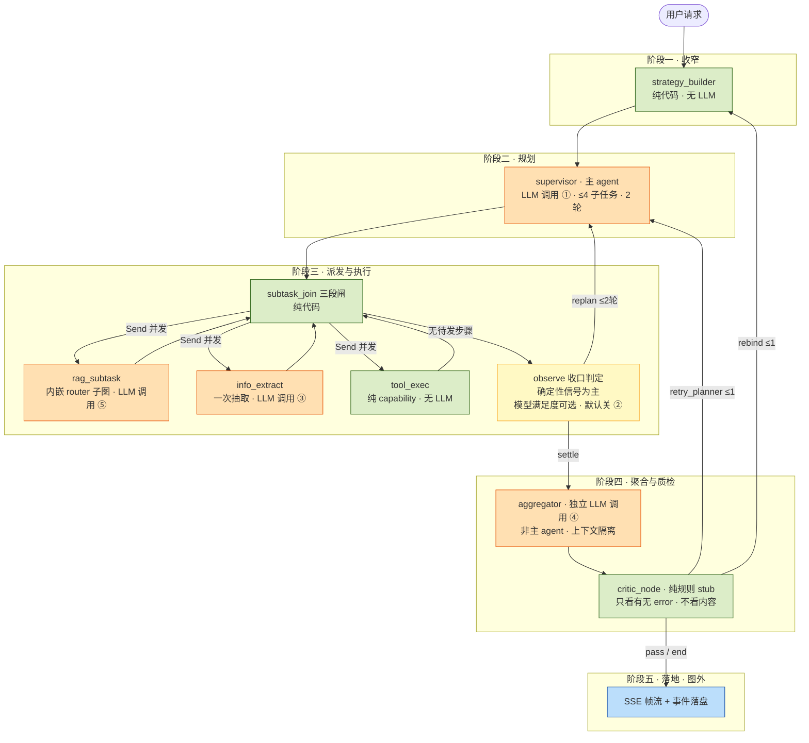

# 11 · supervisor 五阶段流转讲书稿 v1（10min 架构版主轴）

> **定位**：10min 架构版的 5min 主轴。按时间线五阶段讲完一次 run 的完整生命周期。
> **讲法**：每阶段四段 = **看点**（一句话钩子）→ **机制+数字锚点**（带 file:line）→ **这一阶段在哪被观察** → **追问钩子**（预判追问一句话答案）。
> **真源**：docs/08-interview/09 篇 + master 代码抽查（@31924af，PR #282 已确认在 master）。
> ⚠️ 原始 34KB 审核文（/tmp/lg_rag_supervisor_lifecycle.md）已被系统清理丢失；Step 编号映射为近似推断，引用一律以本表 file:line 为准。
> **红线纪律**：讲现状分清「已实现生效 / 默认关闭 / 已知未做」——见 §4 红线表；口径雷区见 §5。

---

## §1 五阶段总览（30 秒连诵版）

| 阶段 | 名称 | 一句话看点 |
|---|---|---|
| 一 | 收窄 | Builder 无 LLM 先把能力菜单收窄成白名单，planner 才上场——**fail-closed 从入口开始** |
| 二 | 规划 | 首次规划失败默认抛错停图——**绝不静默冒充单 rag 成功** |
| 三 | 派发 | Send 按依赖并发，join 闸先校验契约再签发——**缺字段不喂坏数据、改历史交人批** |
| 四 | 聚合 | observe 判「活干完没」，critic 只判「有没有 error」——**没有待发步骤 ≠ 满足了问题，语义验收是已知缺口** |
| 五 | 落地 | 断连只是退订——**执行与 HTTP 订阅解耦，每帧落盘可 replay 取证** |

---

## §1.5 执行者地图（mermaid · 每阶段谁干活）

**图例**：🟧 LLM 调用｜🟨 确定性为主+可选模型闸（默认关）｜🟩 纯代码｜🟦 图外传输层。
**LLM 五调用点全部同档**：①supervisor 规划（multi/nodes.py:1192）②observe 模型满足度（:1716，默认关）③info_extract（:1528）④aggregator（:2139）⑤rag_subtask 内嵌 router 子图（同常量源头）——共用 _ROUTER_PROVIDER/_ROUTER_MODEL（lg_rag/nodes.py:35-40，默认 siliconflow / Qwen3.6-27B，「与 grader 同档小模型」DESIGN §4），env LG_RAG_ROUTER_* 整体覆盖，**无 per-node 分档**。
**设计判断**：把关主力是确定性代码，LLM 只在语义必需处出现；回环全部有硬上限（replan ≤2 轮 / retry_planner ≤1 / rebind ≤1 / 全局 32 步优先）。

---

## §1.6 时间×空间交叉矩阵（转置详表 · 五层为行 × 五阶段为列）

> 与 §1.5 执行者地图互相对照：一图=谁执行，一表=五层在各阶段各干什么。
> 可视版：同目录 `11_five-stage-matrix_v1_zh.html`（横向滚动+冻结列；**本节或 doc 10 相关段落改动时必须同步该文件**）。
> 状态图例：✅已生效 ｜ 🔴默认关/闸控 ｜ ⚠️stub/已知缺口 ｜ ∅刻意为空。

| 层 | 子项 | ①收窄 | ②规划 | ③派发 | ④聚合 | ⑤落地 |
|---|---|---|---|---|---|---|
| 编排 | 做什么（锚点） | strategy_builder 三组求交出菜单，**无 LLM**；菜单上限 64；预算起计（builder.py:37-58 / MAX_SCOPE_IDS=64 :62 / :127） | supervisor 出 plan ≤4（nodes.py:86）；32 步+2 轮双预算（budget.py:18/31）；规划失败 raise 不重试（:1252-1279）；重规划沿用原 sid（:1216-1250） | join 三段闸：契约闸+写孪生步 guard+依赖波次（:893-1029 / :925-967 / :511-542）；整批 Send+逐子任务重签发令牌（:1339-1372 / :1359-1365） | observe 六桶收口（:1656-1689）；aggregator 独立节点上下文隔离（:2129-2164 / :2132）；critic 规则 stub 双上限 1/1（critic.py:47-61 / :27-28）；重规划前缀锁定（critic.py:113-135） | **∅ 图外**——收尾在 run_worker/sse_stream |
| | 防什么错 | 任务未开始先把权限面收小 | 规划失控/无限循环/失败被静默吞 | 重复执行/契约不符/依赖错乱/孤儿子任务 | 半成品当完成/聚合污染主上下文/重试失控/失败被裁剪 | 交付不依赖图还活着 |
| | 状态 | ✅ | ✅ | ✅ | ✅ / ⚠️critic stub | ✅（设计即空） |
| | 叙事钩子 | 「收窄是声明任务域求交，不是预知任务内容」 | 「规划失败是一等公民，有专属 error 帧」 | 「重试不会变成重复扣款」 | 「质检刻意不用 LLM」 | 「执行与传输解耦的物理证据就是这个空格」 |
| 能力 | 做什么（锚点） | baseline_filter 双裁剪 deny_high_risk+deny_write（baseline.py:50-63；判序 :36 永不豁免） | plan 只能引用收窄后的菜单 id（收窄沿链继承） | **七层闸链全链在工人内**（gateway.py:337-466）：验签🔴:347→lookup:351→enabled:363（disabled 报「未找到」同款文案）→**Policy 五闸**:380（policy.py:87-116；闸序=危险程度→副作用→危险形态→输入完整性：①high_risk 高危拒 ②write_not_confirmed 写闸——与 risk_level 独立，medium+write 也默认拒 ③sandbox 形态 ④cli 形态 ⑤tenant_scope_missing；放行键仅 env 全局/Host ctx 单次，HOST_ONLY :23-33 模型 plan 顶层写不生效）→熔断:405（先于配额）→kill/配额:422（默认 64 调用/8 写）→schema:444 | HITL 收口统一建单 _persist_hitl（:1810-1899，幂等键 run_id+subtask_id 以 store 为真相 :1825-1838）；decide 条件更新防双花（store.py:187-191） | 防重 store 🔴默认不启用（__init__.py:111-112）；审计走 logger+span 不落表 |
| | 防什么错 | 幻觉 id——「只裁剪防不住幻觉 id，只拦截暴露写能力」（baseline.py:57-59） | 规划越权 | 越权/滥用/过载/参数畸形，层层递进各有拒绝码 | 并发审批双花/重复建单 | 重复提交防护留位待开 |
| | 状态 | ✅ | ✅ | ✅ / 🔴委派验签默认 off（三档 :277-334） | ✅ | 🔴（doc 13 缺口条目） |
| | 叙事钩子 | 「高危对模型恒不可见——连幻觉出它的机会都没有」 | 收窄不是一次性动作，沿链兑现 | 「七层是链路，五条是一层内部」；验签在 lookup 前——先验证身份再告诉你有没有这东西 | 「写入单点+store 为真相」 | — |
| 模型 | 做什么（锚点） | **∅ 刻意不用 LLM** | 调用点①plan（nodes.py:1192）；全图 5 调用点同档 Qwen3.6-27B（lg_rag/nodes.py:35-40） | 调用点②rag 子图 fresh messages 隔离（:1461/:1423）③info_extract 失败→空结构+标记不中断（:1528-1549）；tool_exec **无 LLM**（:1603） | 调用点④observe 满足度闸🔴默认关（:1692-1740，只能触发 replan 不能放行 :1656-1660）⑤aggregator 综合（:2139/:2147-2152） | usage 末帧落 ops_llm_usage（base.py:177,211-258：无帧不落/不写 0 假账）；degraded 标记跟数据走（gateway.py:1001-1005）；预算检查点🔴（base.py:44-47 零直通） |
| | 防什么错 | 收窄必须确定性——不能让被收窄的对象参与收窄 | 成本可预期 | 工人上下文互染/抽取失败拖垮整批 | A+B≠C；模型自评 | 成本无账/降级不可见/假账 |
| | 状态 | ✅ | ✅ / 🔴无 per-node 分档（what-next） | ✅ | ✅ / 🔴模型闸 | ✅ / 🔴预算检查点 |
| | 叙事钩子 | 「把关主力是确定性代码」第一例证 | — | 「工人是隔离的完整 agent，不是共享上下文的函数调用」 | 「默认开着等于让模型给自己打分」 | 「绝不静默退化，造成任务完成的假象」 |
| 传输 | 做什么（锚点） | run.start 帧携 run_id（sse_stream.py:334-341） | plan 帧→用户实时看到计划 | subtask.* 帧工人**主动推**不轮询（progress_stream.py:78-158）；keepalive 不落盘（sse_stream.py:73-75） | hitl.waiting 帧（sse_stream.py:445-459）；answer delta（:361-363） | done 家族（:474-500）；error 帧**带 stage**（:524-557）；断连=退订；孤儿补偿 300s stale 补 done{disconnected}（run_worker.py:185-238）；resume 幂等 not_interrupted |
| | 防什么错 | 从此刻起全程有帧可追 | 黑盒焦虑 | 前端盲等 | 用户不知道在等什么 | 断连丢任务/错误无定位/重入重复跑 |
| | 状态 | ✅ | ✅ | ✅ | ✅ | ✅ |
| | 叙事钩子 | — | — | 「并行可以，乱序不行」——工人帧必须桥回主流拿全局 seq | — | 「断连只是观众离席，戏照演」 |
| 数据 | 做什么（锚点） | **读**：turns 历史过 6+2 窗口（continuity.py:48-87）；跨轮只携带 query+最终 answer（sse_stream.py:505） | 帧落 run_events（sse_stream.py:306-317） | 帧逐帧落盘；能力回执 receipt_capture；HITL 挂起→checkpointer interrupt 快照（🔴PG saver 闸控 run_worker.py:138-142，默认 InMemorySaver 重启全丢） | HITL 单据表 ops_hitl_requests；resume 异步受理秒回 200（hitl/router.py:520-615） | **三表分工**（models.py:294/306/324）；run_id+seq 唯一 replay 不重跑 LLM；persist_thread_turns 在 done 后（sse_stream.py:503-507）；replay 在飞 409+Retry-After:2（router.py:372-428） |
| | 防什么错 | 上下文不无限膨胀；结论可用、过程不污染 | 规划过程可回放取证 | 执行留证/挂起可恢复 | 审批状态有据可查 | 证据链断裂/回放变重放 |
| | 状态 | ✅（真摘要/query rewrite/memory 注入三件🔴见 §4） | ✅ | ✅ / 🔴PG saver | ✅ | ✅ |
| | 叙事钩子 | 「跨轮携带结论不携带过程」 | — | 「状态全在 PG 里，进程只是无状态执行器」（开关开时） | — | 「replay 是取证不是重跑」 |

**附注 · 证据链三级关联键**（并行工人下不用线性 trace_id）：**run_id 定伞**（每帧必带 sse_stream.py:283，llm_usage/HITL/回执同键可 JOIN）｜**seq 定时序**（uq(run_id,seq) models.py:328；emit 闭包单点分配 sse_stream.py:279-280，工人帧经 progress_stream 桥回主流共享同一序号轴；cursor=make_cursor(rid,seq) :293）｜**subtask_id+agent_role 定并行分支**（payload 内 subtask_id progress_stream.py:95/133；agent_role 为代码固定字面量 nodes.py:1440/1521/1573，LLM 不参与）。Langfuse 侧同理：contextvars 树形嵌套（tracing.py:171-172/:187-194），并行工人=根 trace 下兄弟 span。

**附注 · 闸链时序**（七层不全在派发=错觉澄清）：七层闸链本体全部在阶段③调用点（工人内 invoke 前）执行；两处「体外」配合——阶段①的 baseline_filter 可见集裁剪=事实上的**第零层**（先裁剪后拦截，baseline.py:57-59）；委派令牌的**签发**在 join 派发前（nodes.py:1339-1372 逐子任务重签发），**验签**才在七层①——签发与验签分离。

**读法**：①竖着讲=选一阶段从上往下扫五层显分工（推荐阶段三信息密度最高）；②横着讲=选数据层从①扫到⑤，一条线讲完「可回放可审计」的物理形态；③空格先行=模型层①∅ 与编排层⑤∅ 是最锋利两句；④状态列防打脸=被问「都在跑吗」直接指 🔴/⚠️ 行主动分层，比被拆穿强十倍。

---

## §2 逐阶段详表

### 阶段一 · 收窄（query → strategy_builder）

**看点**：给模型的不是「全部工具」，是「交集后的白名单」——收窄发生在 LLM 之前，连幻觉出高危工具的机会都没有。

**机制+数字锚点**：

- allowlist = candidates ∩ Registry ∩ Policy 基线可见集，**未知 key → 空集非全开**（app/ops/strategy/builder.py:37-58 build_allowlist_from_candidates，stripped 剔除留痕）；strategy_builder_node 无 LLM（builder.py:118-154）。
- **6+2 历史窗口**：6 轮全量 + 更早按 2 轮一组合摘要（app/ops/lg_rag/continuity.py:48-49 常量、52-87 compress_window；⚠️ 09 篇写 44-79 行号偏移，已更正）。
- **32 步预算从 builder 入口起计**（builder.py:127 bump_supervisor_step）；单能力范围上限 MAX_SCOPE_IDS=64（builder.py:62）。
- 跨用户 thread → 404 不泄露存在性（app/ops/lg_rag/router.py:199-213）。

**这一阶段在哪被观察**：span strategy_builder_catalog_count / allowed_count / stripped_ids（builder.py:142-149）；空 allowlist 不是 error——降级单 rag + span supervisor_empty_allowlist（app/ops/lg_rag/multi/nodes.py:1154-1168）；日志「strategy_builder 剔除非法/不可见 capability id」。

**追问钩子**：

- 「为什么不直接让模型自己选工具？」→ 只裁剪防不住幻觉 id，所以可见裁剪和执行拦截双管（capability/baseline.py:57-59）。
- 「收窄成空菜单怎么办？」→ 显式降级单 rag + 标记，不假装 supervisor 跑过。

---

### 阶段二 · 规划（supervisor 拆 plan）

**看点**：首次规划失败默认 fail-closed——一帧 error 帧就是终态，其后没有 done，失败语义用户可见、前端可重试。

**机制+数字锚点**：

- **≤4 子任务**（nodes.py:86 MAX_SUBTASKS，cap 外不校验直接截断 :174-211）。
- **32 步预算**（budget.py:18 DEFAULT_MAX_SUPERVISOR_STEPS，env LG_RAG_SUPERVISOR_MAX_STEPS）⚠️ 口径：是 supervisor **总步**（每节点入口 bump），**不是 32 次 LLM 调用**，也不计 rag 子图步数（graph.py:21 注释）。
- **2 ReAct 轮**（budget.py:33-37 LG_RAG_REACT_MAX_ROUNDS）——步数与轮数是两个维度（graph.py:21-22）。
- supervisor_node = complete 一次 + parse_only，**不双重 LLM**（nodes.py:1125-1207）；非法 tool id → structured fallback。
- 无 locked 前缀（=首次）规划失败 → raise SupervisorPlanError 停图（nodes.py:1252-1279）。

**错误帧**：error{stage:"supervisor_plan", retryable:true} **恰一帧即终态**（sse_stream.py:524-541），经 emit 落 ops_lg_rag_run_events。

**这一阶段在哪被观察**：span supervisor_plan_failed / supervisor_fallback / structured_output_fallback / supervisor_invalid_tool_id / subtask_count / plan_prefix_len（nodes.py:1258-1270, 1316-1335）；日志「lg_rag supervisor 首次规划失败，fail-closed 停图 run_id=%s」。

**追问钩子**：

- 「一点容错都没有吗？」→ 有灾备：LG_RAG_SUPERVISOR_PLAN_ON_FAIL=single_rag 显式 env 开，降级全程带 degraded 标记（nodes.py:1110-1122, 1280-1291）；默认 error 是刻意的。
- 「重规划失败也停？」→ 不停：有 locked 前缀说明已有战果，沿用未解决后缀、**不换 subtask_id**（防重放，nodes.py:1216-1250）。

---

### 阶段三 · 派发（subtask_join → Send 并发工人）

**看点**：join 是派发前的最后一道闸——先校验步骤契约，再签发委派令牌；校验不过的子任务写成带原因码的 blocked 终态，不是模糊报错。

**机制+数字锚点**：

- 拓扑真值：START→builder→supervisor→join→条件 Send；工人→join 回环；observe/aggregator/critic 边（graph.py:96-104 + 52-74 三张条件边映射表；⚠️ 白板讲解别漏 observe 节点；图谱 flow 旧文档仍画 intent_node 是已知滞后，勿照旧讲）。
- route_next_subtask 按依赖+inflight 一批 Send 并发；**逐子任务重新签发委派令牌，重发/重规划一律重签发、禁续期**（nodes.py:1339-1372）。
- join 三段闸（nodes.py:893-1029）：①sc.gate 契约校验 → blocked 错误终态级联停（step_contract.py:58-84，原因码 contract_missing_field / prefix_touch_required→HITL）②delegation_issue_hitl_required 拦签发 ③write_replay_guard 孪生步 guard-skip（异 sid 同 canonical 已成功 → 不派发照抄 output + replay_of 台账）。
- **委派令牌 TTL 600s 墙钟禁续期**（delegation.py:43-46）；**六类拒绝 R-a~R-f**（delegation.py:54-62；⚠️ 口径：6 主类 + R-a 伞下 2 个审计单列 signature_invalid/secret_missing，被追问「篡改归哪类」时答得出）。
- 工人每次工具调用过**七层闸链**（capability/gateway.py:337-468：委派验签347→lookup351→enabled363→Policy380→熔断405先于配额「先谈别打了再谈打几次」→kill switch+配额422→参数校验444）。
- **三类工人按 LLM 分**：rag_subtask 内嵌完整 router 子图（fresh messages 隔离不污染父历史，:1420-1497）；info_extract 一次 LLM 抽取 JSON（:1504-1550，parse_only 失败→空结构+structured_output_fallback 标记不中断）；tool_exec **纯 capability 无 LLM**（:1553-1604）。
- **统一扩展入口**：新能力=manifest 上架，自动继承七层闸链+Policy+配额+熔断；MCP 适配器已在（capability/adapters/mcp.py + mcp_client.py，OPS_CAPABILITY_MCP_ENABLED **默认关**，capability/__init__.py:107-108）；三方 agent 含 LLM 也封装在 capability 内部，编排层只看声明的风险面——「清单只能声明危险，不能豁免危险」。

**这一阶段在哪被观察**：SSE subtask.progress（running/step/done + 可读 message 模板，progress_stream.py:78-134）；span step_contract_blocked(+_by_reason)（nodes.py:1020-1026）、write_replay_guard_skip + replay_of（:974-991）；审计**五动作词表** token_issued / token_issue_hitl_required / token_superseded / token_verified / token_rejected:（delegation.py:65-69）；gateway 侧 span policy_blocked / blocked=circuit|budget|kill_switch / args_schema_invalid。

**追问钩子**：

- 「blocked 和 error 什么区别？」→ blocked 是业务闸判定（带原因码、可转 HITL、经 subtask.progress 表面化），error 帧只给未捕获技术异常（error{stage:"lg_rag.worker_failed"}，sse_stream.py:542-557）。
- 「令牌为什么禁续期？」→ 续期 = 变相扩大授权窗口；重发即重签发，旧 nonce 作废（nonce_reused 拒绝类）。

⚠️ **本阶段红线**：delegation 默认 off（LG_RAG_DELEGATION_MODE，off=整段短路零 diff，delegation.py:95-100）；SECURITY_INPUT_ISOLATION_ENABLED 默认 false（slots.py:27,291-298）。

---

### 阶段四 · 聚合（observe → aggregator → critic）

**看点**：两个收口判定分开做——observe 每轮判「活干完没/要不要人」（过程完备性），critic 收尾只判「有没有 error/要不要回环」；都是确定性判定，**语义级「答案对不对」无人判——已知缺口，见追问钩子**。

**机制+数字锚点**：

- observe_node：确定性信号判定（_observe :1656-1689 六桶 planned/done/pending/failed/blocked/hitl_pending，unsatisfied = failed or pending；blocked 单独分桶——被闸拦的可能该 rebind 而非 retry），verdict=replan/settle（nodes.py:1984-2050）；**hitl_pending → interrupt() 真挂起**；可选模型满足度闸 _satisfied_by_model **默认关**（LG_RAG_REACT_SATISFACTION，:1692-1740）——「默认开着等于让模型给自己打分」，开了也只能触发 replan，**不能放行**（放行权永远在确定性信号+轮次上限，:1656-1660）。
- aggregator_node **独立节点 + 独立 LLM 调用（非主 agent）**：中间结果只在 subtask_results **不进 messages**（:2132 上下文隔离——主 agent 的对话上下文里根本没有工人产出，所以综合必须是一次新的 LLM 调用，拿结构化 payload 去做）；自建 prompt（:2064/:2075）+ complete_answer_streaming（:2147-2152）；空输出回退**确定性拼接**子任务原文（:2153-2163，不是编造兜底），异常上抛（:2132）；计入 32 步预算（:2135）；token 经 answer_stream 桥流式出帧（answer_stream.py:1-24 contextvar sink——只有终答 token 进 SSE）。
- **A+B list ≠ answer C 正是 aggregator 存在的原因**：list 拼接不是答案，聚合拿原始 query+全量 payload 语义综合。
- **critic = 规则 stub 纯函数**（app/ops/strategy/critic.py:1 文件头自述「S4 · 无 LLM 主路径」；:47-61 decide_critic_verdict：无 error→pass / error+空 allowlist→rebind / error+非空→retry_planner / 全局预算耗尽→强制 end）。
  - ⚠️ critic 的**全部**输入是 _has_error（critic.py:36-39：结果字典有无 "error" 键）——不看答案文本、不校验内容质量；observe 注释自证（nodes.py:1993「critic 在 aggregator 之后，而且只看有没有 error」）。
- **重规划保前缀，不是全量重来**（critic.py:113-135）：回环 keep=已成功前缀+未解决后缀，写 plan_prefix_ids/recoverable_point；未解决后缀**必须跟着走**（:118-122——只留前缀=失败记录被裁成「计划外 id」→结论写成「已覆盖全部子任务」，失败静默抹掉）；已成功的连计划带结果原地锁定不重跑，叠加 supervisor 沿用原 sid（nodes.py:1216-1250）+ 写孪生步 write_replay_guard_skip（:925-967）。
- **MAX_INNER_RETRIES=1 / MAX_REBINDING=1**（critic.py:27-28）；**全局 32 步/墙钟耗尽优先于局部 1+1 回环额度**（critic.py:54-56, 80-81）。

**这一阶段在哪被观察**：SSE answer delta + 终帧 {content, final:true}（sse_stream.py:361-363, 196-204）；span react_round / react_verdict / react_unsatisfied / react_hitl_pending（nodes.py:2036-2044）、critic_outcome / inner_retry_count / rebinding_count（critic.py:142-149）。

**追问钩子**：

- 「critic 为什么不用 LLM？」→ 收尾判定要确定性、可测试、可重现；LLM 评委引入不可重现性，stub 是设计如此（讲现状必须这么说）。
- 「怎么保证最终答案质量？」→ 照实答三段式：observe 判过程完备（做完没）、aggregator 综合（A+B→C）、critic 只看有没有 error——**C 产出后无语义验收是已知缺口**；what-next=独立 Result agent：只看 query+答案+证据摘要不看规划过程（避免自评——「让模型给自己打分的事默认不干」），**只能否决不能放行**（触发 retry/replan/degraded 标记，路由必须显式）。
- 「HITL 挂起靠什么？」→ 真靠 checkpointer：interrupt 期间节点 return 不进 checkpoint（nodes.py:2003-2005）——所以 Postgres checkpointer 闸控开启前，跨进程/重启不可恢复是明示边界，不是暗坑。

---

### 阶段五 · 落地（SSE 逐帧落盘 / 断连 / 孤儿补偿 / replay）

**看点**：SSE 是「只读订阅者」——断连只是退订，worker 照跑；每一帧都是一条数据库记录，事后可以不重跑 LLM 原样回放。

**机制+数字锚点**：

- emit：seq 单调 + 后台 persist_run_event 落 ops_lg_rag_run_events（run_id+seq 唯一，sse_stream.py:278-328；表 models.py:327-328）⚠️ 口径：落盘以 if user_id 为条件（:295）且后台尽力（persist 失败只 log 不阻断已发帧 :318-323）——HTTP 路径必登录故实际全落，但不说「每帧必落」。
- 断连 = aclose 本订阅，**不 cancel worker**（sse_subscribe.py:59-63）；**不赌 ASGI disconnect 事件**（Wave A 裁定）。
- run_id 单飞：进程内 dict（run_worker.py:93-165）——⚠️ 多副本 DB 租约已知未做。
- **孤儿补偿**：无终帧且无活跃 worker → 补 done{status:"disconnected"}，默认陈旧 **300s**（run_worker.py:185-238，env LG_RAG_ORPHAN_STALE_SECONDS）。
- **replay**：cursor 非法 422 / 跨用户 404 / 在飞 409+Retry-After:2，seq>after_seq 重放（router.py:372-428）——刷新页面 = 断点续看，不重跑 LLM。
- **30s keepalive comment**：不落盘、不占 seq（sse_stream.py:73-75）。
- 审批消费 TTL **3600s**（nodes.py:296-310）；resume **异步受理**秒回 200（hitl/router.py:520-615；同步实测 130-310s 超前端 30s 超时——所以必须异步），恢复段帧照常同 run_id 落盘，前端靠 replay.cursor 追帧。

**这一阶段在哪被观察**：终帧家族四态——done（正常）/ done{degraded:true}（灾备）/ done{status:"waiting_approval"}（等人批）/ done{status:"disconnected"}（断连/孤儿补偿）全部落表（sse_stream.py:370-500）；结构化日志「lg-rag orphan compensated」「lg-rag event persist failed」「lg-rag run_worker single-flight reuse」。

**追问钩子**：

- 「进程崩了呢？」→ 孤儿扫描 300s 后补 disconnected 终帧，已落盘的帧 replay 仍可取——失败语义显式，不是挂着没人管。
- 「多副本部署怎么办？」→ 照实说：单飞是进程内 dict，DB 租约是已知边界未做。

---

## §3 SSE 帧全清单（event_type 取值）

| event_type | 含义 | 产出处 |
|---|---|---|
| run.start | 起步帧 {run_id, thread_id, mode, query}（query 是历史面标题真源） | sse_stream.py:334-341 |
| answer（delta） | 终答 token 流 {delta}；仅 aggregator/direct_answer token 进 SSE（contextvar sink 桥） | sse_stream.py:361-363；answer_stream.py |
| answer（final） | 终答整段 {content, final:true}；basic/router 无 aggregator 补 {content:"", note:"no_aggregator"} | sse_stream.py:196-204, 488-489 |
| subtask.progress | 子任务进度：running / step（里程碑+detail）/ done（完成摘要+可读 message） | progress_stream.py:78-134；sse_stream.py:184-195, 365-368 |
| node.progress | 非子任务非终答节点的 updates 摘要（strategy_builder/observe/critic_node 等） | sse_stream.py:205 |
| hitl.waiting | 图被 interrupt() 挂起：{reason:"hitl_waiting", requests:[…], unpersisted}，恰一帧后 break | sse_stream.py:445-459 |
| done | 正常终帧 {run_id, thread_id, latency_ms}；灾备降级附加 degraded:true | sse_stream.py:490-500 |
| done{status:"waiting_approval"} | HITL 挂起终帧（在等人批，不是跑完了） | sse_stream.py:474-487 |
| done{status:"disconnected"} | 断连/孤儿补偿终帧（worker 内补偿 + 孤儿扫描补偿同语义） | sse_stream.py:370-389；run_worker.py:218-231 |
| error{stage:"supervisor_plan"} | 规划失败 fail-closed 终帧，retryable:true，恰一帧即终态（其后无 done） | sse_stream.py:524-541 |
| error{stage:"lg_rag.worker_failed"} | 旁路流式调用未捕获异常终帧，retryable:true | sse_stream.py:542-557 |
| （非 event_type）keepalive | SSE comment 保活，30s 周期，不落盘不占 seq | sse_stream.py:73-75；sse_subscribe.py:51-54 |

收尾判定面：event_type ∈ {done, error} 即 run_stream_closed 真（event_store.py:116-118, 144, 170），replay 409 据此判定。

---

## §4 红线表（本维度 default-off / stub / 未做全集）

| 项 | 状态 | 锚点 | 口径 |
|---|---|---|---|
| delegation 委派令牌 | 默认 off（off=整段短路零 diff） | delegation.py:95-100；LG_RAG_DELEGATION_MODE | 「三档灰度 off/observe/enforce，先量后闸」 |
| Postgres checkpointer | 闸控默认关（InMemorySaver 默认） | checkpointer.py:27-38；LG_RAG_HTTP_CHECKPOINTER | 「恢复入口显式报错，不假装成功」 |
| critic | 规则 stub 无 LLM | critic.py:1,47-61 | 「设计如此：收尾判定要确定性可重现」 |
| observe 模型满足度 | 默认关（LG_RAG_REACT_SATISFACTION） | nodes.py:1692-1740 | 「让模型给自己打分的事默认不干；开了也只能触发不能放行」 |
| MCP 能力注册 | 默认关（OPS_CAPABILITY_MCP_ENABLED） | capability/__init__.py:107-108；adapters/mcp.py | 适配器已在，闸控开启才注册 |
| 语义级 Result 验收 | **未做**（critic 只看 error） | critic.py:36-39 | what-next：独立 Result agent，只能否决不能放行 |
| MEMORY_FACTS / memory 注入 | 默认关 + supervisor 主链路零消费 | graph.py:161-162；nodes.py:1193-1199, 2064-2072 | 「机制已证零消费（双方自建 prompt），运行时实证待跑」 |
| SECURITY_INPUT_ISOLATION | 默认 false | slots.py:27,291-298 | 闸控装配 |
| Langfuse tracing | env 开关默认关（no-op 零成本） | tracing.py:1-11；OPS_CHAT_TRACER | 「可选装配，不开不影响主链路」 |
| metrics | 进程内计数 | metrics.py:11-13 | 多实例各一份已知边界 |
| RunWorker 单飞 | 进程内 dict | run_worker.py:93-165 | 多副本 DB 租约未做，照实说 |
| 孤儿补偿接线 | 2026-10-20 完成接线（口径） | run_worker.py:185-238；挂点 file:line **待回填** ← 用户侧 | 同 doc 10 §3.5 |

## §5 口径修正清单（被追问时别踩雷）

1. ❌「32 次 LLM 调用」→ ✅ supervisor **总步** 32（每节点入口 bump，不含 rag 子图步数，graph.py:21）。
2. ❌「六类拒绝」被追问「篡改归哪类」→ ✅ 6 主类 + R-a 伞下 2 审计单列 signature_invalid / secret_missing（delegation.py:54-57）。
3. ❌「每帧必落盘」→ ✅ if user_id 条件 + 后台尽力（persist 失败只 log 不阻断，sse_stream.py:295,318-323）；keepalive 不落不占 seq。
4. ❌「resume 同步续跑」→ ✅ **异步受理**秒回 200，前端 replay.cursor 追帧（hitl/router.py:520-615）。
5. 6+2 窗口行号：continuity.py:48-87（09 篇写 44-79 是偏移，内容属实）。
6. 拓扑白板别漏 **observe 节点**；条件边映射表在 graph.py:52-74（96-104 只是边注册段）。图谱 flow 旧文档仍画 intent_node 是已知滞后，勿照旧讲。
7. 「事件流/run_id」：resume 后帧接同一 run_id 续 seq 语义属实，但机制是异步受理+replay 追帧，不是同步续跑。
8. 步数与轮数两个维度：32 步是全局预算，2 轮是 ReAct 收口次数（budget.py:18 vs :33-37）。
9. ❌「observe 纯确定性」→ ✅ 确定性信号为主 + 可选模型满足度闸**默认关**（nodes.py:1692-1740）。
10. ❌「critic 判答案行不行」→ ✅ critic 只看有无 error（critic.py:36-39）；「答案对不对」无语义验收=what-next（独立 Result agent）。
11. ❌「工人都是纯执行」→ ✅ rag_subtask 内嵌 router 子图、info_extract 一次 LLM 抽取，仅 tool_exec 无 LLM；全图 LLM 调用**同档**（_ROUTER_PROVIDER/_ROUTER_MODEL，lg_rag/nodes.py:35-40），无 per-node 分档——被问「聚合用小模型够吗」接「按节点分档」作 what-next。

## §6 时长压缩锚点

- **30 秒版**（电梯）：§1 总览表五句连诵 + 收尾「全链路的纪律就一条——失败显式化：每一阶段的错误都有专属帧、专属 stage、专属落盘位置，没有任何一处静默」。
- **2 分钟版**：每阶段一句看点 + 一个数字（6+2 / 4 子任务 / 600s / 1+1 回环 / 300s），观察段全砍，只留阶段五一句「断连只是退订」。
- **10 分钟版**：本稿全量（5min 五阶段 + 前后衔接见 doc 09/10）。

## §7 阶段交付物落盘 / 观测映射（只读核查 · master @ e952984）

> 用途：回答「每个阶段的交付物在哪里能看到 / 落在哪里」——叙事时每个「看点」都能指出证据载体。完整 17 行细表存档 `docs/tmp/stage-artifact-collection-report_e952984_zh.md`。

### 7.1 载体写入点速记（先记这些，后表只引用）

| 载体 | 写入点 | 默认状态 |
|---|---|---|
| SSE 帧 → `ops_lg_rag_run_events` | emit() sse_stream.py:278-328 → event_store.py:31-58（唯一键 run_id+seq） | ✅ 有 user_id 即落（后台 task，失败仅 logger） |
| replay 读路径 | load_events_after event_store.py:225-265 → POST /lg-rag/replay router.py:382-428（在飞 409） | ✅ |
| capability 回执 → `ops_capability_receipts` | DbReceiptSink receipts.py:195-234；仅 OPS_CAPABILITY_PERSISTENCE=db 装配（persistence.py:31-67） | ❌ 默认 NullReceiptSink 只 logger.warning（:68-74） |
| HITL 申请 → `ops_hitl_requests` | DbHitlStore hitl/store.py:155-236；仅 OPS_HITL_PERSISTENCE=db | ❌ 默认 NullHitlStore 不落库 |
| delegation 审计 | audit_delegation delegation.py:132-147（logger.info + span 键，五动作词表 :65-69） | ⚠️ **设计如此不落表**（:64「记动作不记内容 · 不落新表」） |
| metrics | 进程内 dict metrics.py:24-39；snapshot → GET /admin/capability/metrics（admin/capability.py:271-279） | ⚠️ 进程内，重启归零、多实例各一份 |
| Langfuse span | trace_span tracing.py:162-210；nodes 统一 _record_span_metadata nodes.py:222-234 | ❌ 默认关（OPS_CHAT_TRACER） |
| checkpointer | InMemorySaver graph.py:51-53；PG 需 LG_RAG_HTTP_CHECKPOINTER=postgres 且仅 supervisor 模式装配（run_worker.py:138-142） | ❌ 默认内存 |

### 7.2 主表（阶段 × 交付物 → 落盘/观测处）

| 阶段 | 交付物 | 在哪看 / 落在哪 |
|---|---|---|
| ① 收窄 | allowlist、预算起计 | SSE `node.progress`（role=strategy_builder，sse_stream.py:205,473；摘要键表 :94-102）→ run_events；state `allowed_capability_ids`（builder.py:150-154）；span `strategy_builder_*`（:142-149）。⚠️ stripped 明细仅 logger.warning（:54-57） |
| ② 规划 | plan / delegation_scope / 失败路径 | SSE `node.progress`（subtasks ≤800 字符摘要）→ run_events；`error{stage:supervisor_plan}` 恰一帧即终态（sse_stream.py:524-541）；state subtasks/plan_prefix_ids/recoverable_point（:656-708）；span `subtask_count`/`supervisor_fallback`/`replan_*`（:1316-1335）。⚠️ supervisor_raw 全文仅 span |
| ③ 派发执行 | 令牌签发/拦截、工人进度、subtask_results、契约拦截 | SSE `subtask.progress` running/step/done 全落 run_events（progress_stream.py:78-158）；契约拦截/重放守卫写 subtask_results + span `step_contract_blocked`（:1020-1026）/`write_replay_guard_skip`（:985-991）；capability span 键全（gateway.py:1298-1343）+ metrics record_outcome（gateway.py:193/:208）；写能力回执无论成败落（:522-532/:544-554，需 persistence=db）；HITL 申请落 ops_hitl_requests（需闸；未落库则 hitl.waiting{unpersisted:true} + logger.error nodes.py:1893-1897）。⚠️ delegation 审计不落表；react_observation 全文无持久化载体（不在 SSE 摘要键表 :94-102，span 只有 react_* 计数 :2036-2044） |
| ④ 聚合质检 | answer、critic_verdict | SSE `answer` delta **每帧一行**落 run_events（:361-363，T5.1 刻意设计，长回答行数多——口径注意）+ final 终帧；critic_verdict → node.progress + state + span（⚠️ inner_retry_count 不在 SSE 摘要键表）；done 后 persist_thread_turns（sse_stream.py:503-507）。⚠️ aggregator span 无附加 metadata 键（nodes.py:2140） |
| ⑤ 落地 | run.start/done 家族/error、replay、resume | run.start/done/error 全落 run_events；收尾判定 run_is_terminal event_store.py:94-126 / run_stream_closed :129-149；keepalive 不落盘（发射主路径 sse_subscribe.py:44-53）；resume 恢复段帧同 run_id 续 seq（hitl/resume.py:87-156），受理响应含 replay.cursor（hitl/router.py:587-615） |

### 7.3 裸奔点清单（无持久化载体 / 默认配置重启即丢）——what-next 现成素材

1. **delegation 审计五动作**：只 logger+span，明写不落表（delegation.py:64,132-147）；tracing 关 → 只剩进程日志。
2. **capability metrics**：进程内 dict（metrics.py:24-39），重启归零、多实例各一份（:11-13）。
3. **delegation nonce registry / issuer seq / supersede 台账**：进程内（delegation.py:395-398），一次性 nonce 消费状态重启即丢（TTL 600s 兜底）。
4. **LangGraph state 全部键**（subtasks/subtask_results/react_observation/delegation_token/plan_prefix_ids…）：默认 InMemorySaver 重启即丢；PG saver 闸控且仅 supervisor 模式（run_worker.py:138-142）。
5. **react_observation 全文**：SSE 摘要不含、span 只有计数 → 正文无任何持久化全文。
6. **supervisor_raw（LLM 原始 plan 文本）**：仅 span 键（nodes.py:1316-1335）；tracing 关即无载体。
7. **builder stripped 明细 / scope_stripped / scope_truncated**：仅 logger.warning（builder.py:54-57,93-102）。
8. **capability 回执**：默认不落库；启动告警「不可上生产」（persistence.py:63-66）。
9. **HITL 申请**：默认不落库；留痕只有 SSE unpersisted 标记 + logger.error（nodes.py:1893-1897）。
10. **RunEventBus._history / _workers / _RESUME_IN_FLIGHT**：进程内（run_worker.py:30-71、hitl/router.py:467-470）。
11. **纯 logger 行**：aggregator 空输出回退（nodes.py:2154-2163）、supervisor 非法 tool id（:1203-1206）、hitl_persist_guard_*（:1780-1785,:1873）、orphan 补偿（run_worker.py:237）、resume 各阶段（hitl/router.py:451-458,501,516,574）、auto_resume 审计（auto_resume.py:118-137）。

> 面试用法：被问「可观测性做得怎么样」，先讲 7.1 载体矩阵（哪些默认开、哪些闸控），再主动亮 7.3——**裸奔点全部已知，且每条都有对应开关或设计理由**（delegation 不落表是刻意的最小化审计；回执/HITL 落库是闸控默认关）。「知道哪里裸奔」比「声称全可观测」可信得多。

### 7.4 锚点勘误

- `resume_request` 实际区间 **hitl/router.py:520-615**（异步投递 :579-584）——本稿前文两处已修正。
- `write_replay_guard_skip` 函数区间实为 **nodes.py:960-996**（结果行字段 :970-971、logger :974-984、span :985-991）。
- event_store 收尾判定函数头：run_is_terminal :94-126 / run_stream_closed :129-149 / list_open_runs :152-（此前锚点 :116-118/:144/:170 指的是 SQL WHERE 行，行号本身没错）。
- keepalive 发射主路径在 sse_subscribe.py:44-53（sse_stream.py:73-75 为常量+单测保留）；两侧均不落盘，结论不变。

## §8 派发阶段案例集（帧序列级复盘 · 测试佐证）

> 用途：讲阶段三不抽象——四个真实代码路径案例，每个给「计划 → 机制 → 帧序列 → 落盘/观测」。统筹机制一句话：**主 agent 不轮询也不傻等**——Send 是声明式派发（route_next_subtask 一次返回整批 nodes.py:1351-1366），等齐是图屏障语义（三工人各有一条边回 join，graph.py:100-101），进度是工人主动推帧（progress_stream.py:78-158）。

### 案例 A：无依赖混合批 —— 一波并发

- **计划**：s1=rag、s2=rag、s3=extract，均无 depends_on
- **机制**：join 收齐后 inflight=[s1,s2,s3]（nodes.py:1019）→ 一次 Send×3 → 三工人并发 → 图屏障等整批到齐 → join 写回 subtask_results → inflight 空 → route_next_subtask 返回 observe（:1367-1371「没有待发步骤 ≠ 满足了问题」）
- **帧序列**：node.progress(supervisor) → subtask.progress{running}×3 → {step} 若干 → {done}×3 → node.progress(observe)
- **落盘**：全帧 ops_lg_rag_run_events；state subtask_results 三条

### 案例 B：depends_on 两波 —— 依赖驱动波次

- **计划**：t1=tool（如查库存）、s2=rag depends_on=[t1]
- **机制**：wave1 只 Send t1；t1 终态后 join 重算 ready → wave2 才 Send s2（nodes.py:9「有 depends_on 的等前驱终态再下发」；_resolve_depends :511-536：无法解析/指向自身/指向计划外 → 整项不派；成环检测 :542）
- **叙事点**：波次 = 依赖分层，不是固定并发窗口；非法依赖宁可整项不派——fail-closed 在调度层的又一样本

### 案例 C：写孪生步 guard-skip —— HITL 批准重规划后的零重发

- **场景**：写步被 HITL 拦截 → 批准 → 重规划产新计划，其中写步换了 sid 但 canonical 调用键与已成功旧步相同
- **机制**：join 查「已成功写键索引」命中 → 不派发、照抄上次 output，写 write_replay_guard_skip=true + replay_of=旧 sid 台账（nodes.py:960-996；span :985-991；logger :974-984；默认开，LG_RAG_WRITE_REPLAY_GUARD_ENABLED 可关回基线）
- **佐证**：tests/test_lg_rag_write_replay_guard.py:130,183,237；tests/test_hitl_approved_replan_quality.py:111,272
- **叙事点**：「批准重规划 ≠ 重新执行」——写零重发是结构护栏，不靠模型自觉

### 案例 D：契约拦截 —— 坏数据不喂下游

- **场景**：工人回包缺 step contract 声明的字段
- **机制**：join 拦截 → blocked 行写 subtask_results + span step_contract_blocked / step_contract_blocked_by_reason（nodes.py:1020-1026）→ critic 见 error → rebind 换能力重绑
- **叙事点**：契约校验是机器判字段完整性，LLM 不参与把关

---

v1.4 · 2026-10-26 · 增 §1.6 时间×空间交叉矩阵转置详表（五层×五阶段×四子项：做什么锚点/防什么错/状态/叙事钩子）+ 证据链三级关联键附注 + 读法四条。
v1.3 · 2026-10-21 · 增 §8 派发阶段案例集（A 无依赖并发 / B depends_on 两波 / C 写孪生步 guard-skip / D 契约拦截，帧序列+测试佐证）+ 统筹机制一句（声明式 Send+图屏障+工人推帧，主 agent 不轮询）。
v1.2 · 2026-10-21 · 增 §7 阶段交付物落盘/观测映射（子代理只读核查 master@e952984：载体速记 8 类 + 主表 + 裸奔点 11 条 + 锚点勘误）；resume 锚点修正 :520-615。
v1.1 · 2026-10-21 · 增 §1.5 执行者地图 mermaid；四类修正（observe 模型闸默认关/critic 只看 error/工人 LLM 分布/LLM 同档）+ 重规划前缀锁定 + 语义验收缺口（v1 · 2026-10-20 · 真源：09 篇 + master@31924af 子代理逐锚点抽查，原始 34KB 审核文已失，本表接替其证据链角色）
