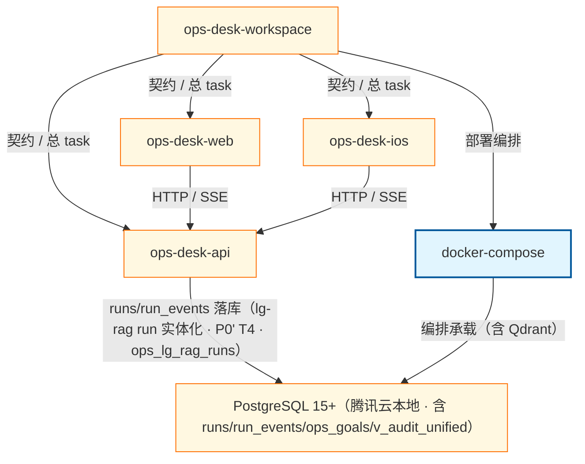

# ops-desk-workspace 跨仓总图（最小骨架）

四仓锚点级总图；契约与数据流细节另 task 充实。四仓均接入 SpecWave（各仓自钉）。

## Mermaid

## Structured Data

### Nodes

| ID | Label | Kind |
|----|-------|------|
| workspace | ops-desk-workspace | struct |
| api | ops-desk-api | struct |
| web | ops-desk-web | struct |
| ios | ops-desk-ios | struct |
| compose | docker-compose | flow |
| pg | PostgreSQL 15+（腾讯云本地 · 含 runs/run_events/ops_goals/v_audit_unified） | struct |

### Edges

| From | To | Mark | Type | Label | Anchors |
|------|----|------|------|-------|---------|
| workspace | api | -> | depends_on | 契约 / 总 task |  |
| workspace | web | -> | depends_on | 契约 / 总 task |  |
| workspace | ios | -> | depends_on | 契约 / 总 task |  |
| workspace | compose | -> | depends_on | 部署编排 |  |
| web | api | -> | depends_on | HTTP / SSE |  |
| ios | api | -> | depends_on | HTTP / SSE |  |
| api | pg | -> | depends_on | runs/run_events 落库（lg-rag run 实体化 · P0' T4 · ops_lg_rag_runs） |  |
| compose | pg | -> | depends_on | 编排承载（含 Qdrant） |  |

## Sub-graph Links

- `Struct`: [`01_struct.md`](01_struct.md)（手写 · 无 `.graph.yaml`）
- `Version`: [`02_version.md`](02_version.md)（手写 · 无 `.graph.yaml`）
- 子图编辑源见 `docs/_tech_graph/*.graph.yaml`

