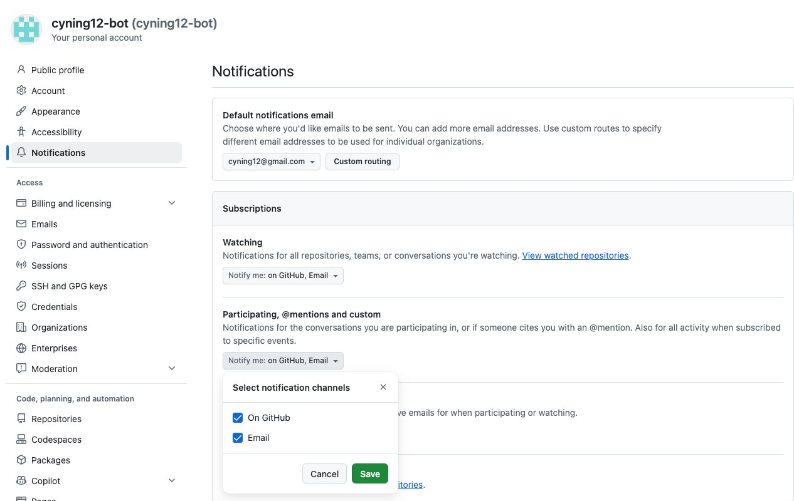
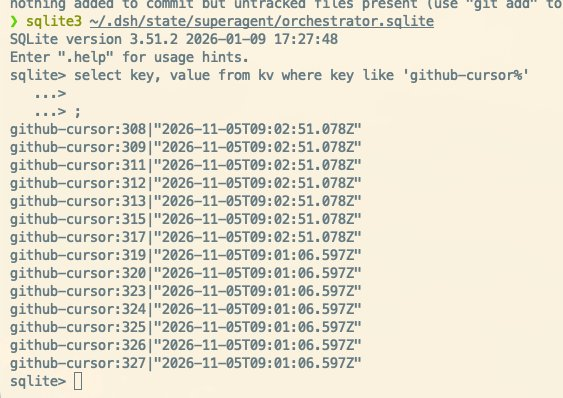
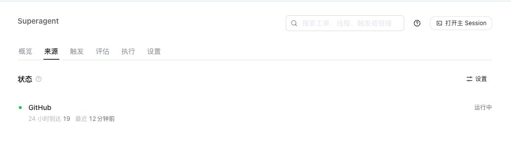
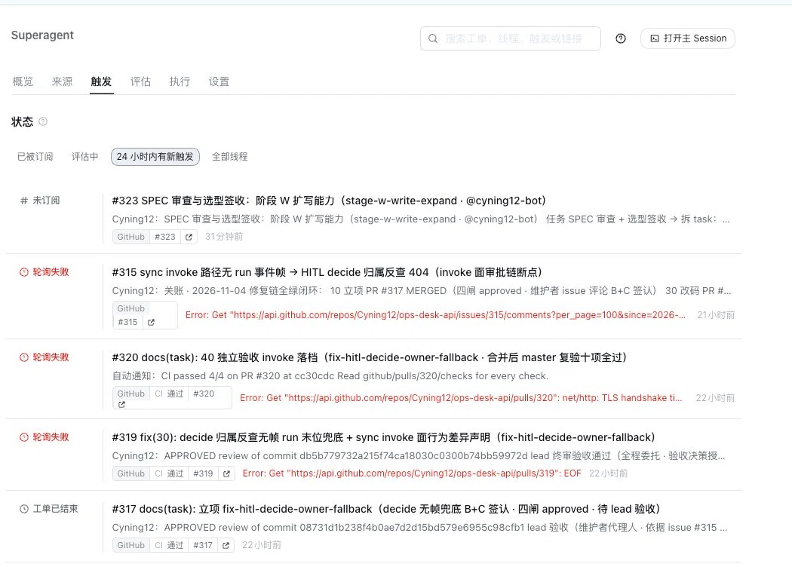

# 06 · 案例：首次触发排障（issue #308）

**TL;DR：** bot 没反应按四层查：是不是忘了 @（设计使然）→ bot 账号通知开关 → 游标丢了旧事件（补发评论）→ tmux 环境没代理。每层修法都已沉淀为 09 篇条目。

> 第一个判例：bot 装好了却对 issue 毫无反应。三层故障，三种解法，全部有诊断逻辑可复用。
> 结论先行：**装好后第一次触发失败，大概率不是 superagent 的问题，而是账号/网络层的问题。**

## 现象 1：开了 issue，bot 完全没反应

- 这是**设计使然**：Policy 名单内的人也必须 **@cyning12-bot** 才构成 mandate，普通评论/开 issue 不触发。
- 用户 @ 了之后依然没反应 → 进入现象 2。

## 现象 2：bot 的通知 API 恒空（根因：账号通知设置）

诊断链：

1. 以 bot 身份查 notifications API（`gh-agent api notifications`）——**恒空**。
2. 对照实验：mention（11:31）和 assignment（11:40）都不产生通知——**不是 mention 解析问题，是通知根本没生成**。
3. 查 GitHub 官方文档定位：账号 settings/notifications 里 **"Participating and @mentions" 的 "On GitHub"** 未勾选 → 通知 API 因此恒空。

解法：用户打开开关。



**教训**：bot 是 2017 年的老账号，默认通知设置可能从未动过。新账号/新 bot 装上后第一件事检查通知设置。

## 现象 3：开了开关，旧 @ 依然不来（根因：轮询游标）

诊断链：

1. 面板看来源健康正常，新 poll 正常进行。
2. 翻 superagent 的 sqlite 状态库 `~/.dsh/state/superagent/orchestrator.sqlite`（表 `kv`），发现 `github-cursor:308` 键。
3. 理解机制：**通知只是"该线程有新东西"的提示，真正的事件靠游标**——游标 = 上次读取时间，poll 时只取游标之后的事件。03:31 的 @ 早于上一轮 poll 的时间点，被游标跳过，且不补发。


> 拍摄位置：终端 sqlite3 ~/.dsh/state/superagent/orchestrator.sqlite

解法：**以 Cyning12 身份在 #308 补发一条相同的 @ 评论**（新事件 > 游标）→ 下一轮 poll 触发：flow received/judged/accepted=1 → Ticket working → bot 04:02 回"收到"，04:08 交付分析 → ticket ended。

**教训**：游标机制下，"漏掉的历史事件"不会补发。要么补发评论制造新事件，要么直接操作 sqlite 游标（不推荐）。

## 现象 4：面板报 GitHub 来源连续轮询失败 EOF（根因：tmux 环境无代理）

诊断链：

1. 本机走代理（Clash 127.0.0.1:7890）访问 api.github.com。
2. superagent 用 tmux 托管——**tmux 新 session 继承的是 tmux server 的环境，不是你终端的环境**，server 起来时没有代理变量。
3. gh-agent 直连 api.github.com → 不稳 → poll EOF。

修复后常态（来源 tab：运行中 · 最近 N 分钟前正常到达）：



失败侧（触发 tab 历史：轮询失败条目常驻，EOF 与同族 TLS handshake timeout 可见）：


> 拍摄位置：面板 → Source

解法（两层，都必要）：

```bash
# 层 1：注入 tmux server 全局环境（防重启丢）
tmux set-environment -g https_proxy http://127.0.0.1:7890
tmux set-environment -g http_proxy http://127.0.0.1:7890
tmux set-environment -g all_proxy socks5://127.0.0.1:7890
tmux set-environment -g no_proxy 127.0.0.1,localhost
tmux set-environment -g NODE_USE_ENV_PROXY 1
```

```bash
# 层 2：gh-agent wrapper 硬编码代理默认值（见 02 篇）
: "${https_proxy:=http://127.0.0.1:7890}"   # 仅外部未设时才默认
```

- 不需要 restart dsh：gh 子进程每轮 poll 新起，读的是新 wrapper；worker 未打断，轮询立即恢复连续正常。

**教训**：凡是被守护进程托管的服务，"我终端里能通"不等于"它能通"。先查 `tmux show-environment -g`。

## 本案例的方法论小结

1. 分层定位：行为层（设计规则）→ 账号层（通知设置）→ 状态层（游标）→ 网络层（代理）。
2. 每个根因都先用对照实验缩小范围（mention vs assignment）。
3. 状态库 sqlite 是排障金矿——`kv` 表能看到每个线程的游标。
4. 修复优先选不打断在跑 worker 的方案（wrapper 层修，而不是 restart）。
