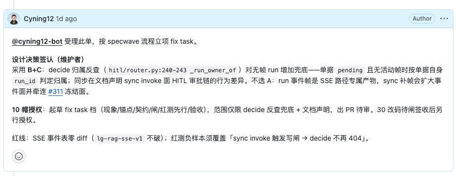
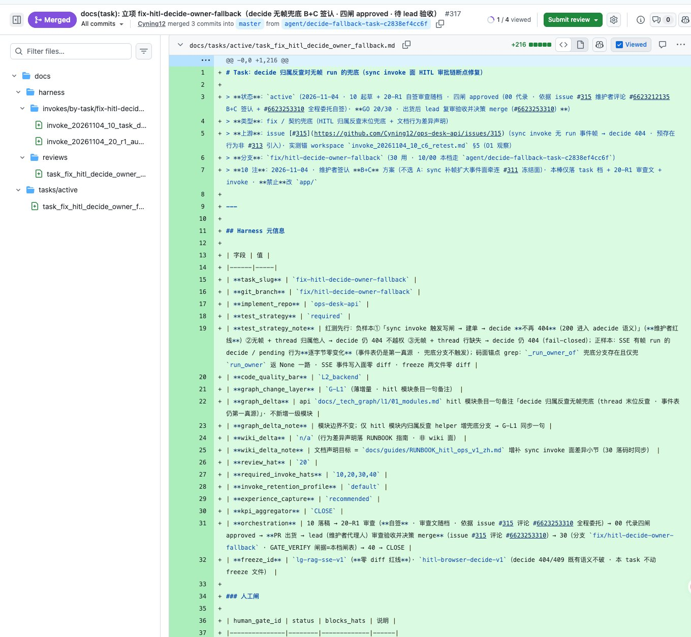
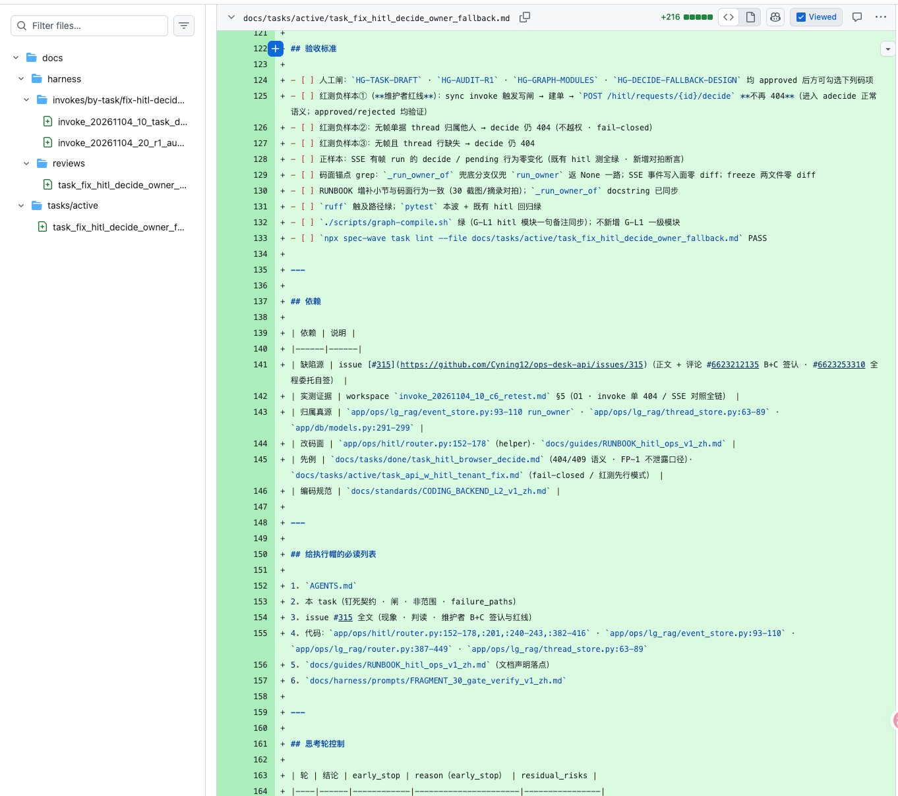
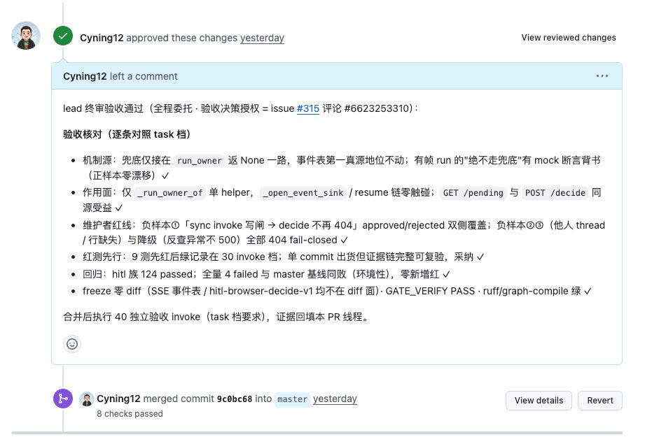

# 08 · 案例：全程委托跑通（issue #315 / PR #317 / PR #319）

**TL;DR：** 签认选项 + 一句 00 委托授权后完全脱离循环：bot 自签四闸（每处引用签认评论）、代拟审查文、做到 PR；代理人终审两份 PR 合并。用户全程只做"签认选项、看报告"。

> 委托模式（"你签认选项，00 全程自跑，我终审 merge"）的首次完整闭环。
> 价值：验证了 05 篇的授权机制设计真的 work——全程零人工干预，审计链完整。

## 1. 任务与选项裁决

issue #315：sync invoke 写入的闸没有 run 事件帧 → decide 反查归属 404 → invoke 面审批链断点。预存在问题（非 #313 引入）。
bot 给了三个选项：A 补帧 / B 反查兜底 / C 文档声明。

分析（我推荐 B+C，用户采纳）：

- A 扩大事件面，牵连 #311 冻结的 SSE 事件表——违反"只读、冻结"的既定决策；
- B 改动最小、fail-closed 不变、freeze 安全；
- C 零代码，声明 sync 面行为差异。

**立项坑**：issue 正文没 @cyning12-bot → 名单内未@ = ignore（见 09 篇症状 10）。受理评论里必须带 @。

受理评论要素（范式）：@ + 选项签认（B+C）+ 10 帽授权 + 红线（SSE 事件表零 diff；红测覆盖"sync invoke 写闸 → decide 不再 404"）。

## 2. 全程委托授权（第二评论）

```markdown
@cyning12-bot 补充授权：00 帽全程自签过程文档（闸表签收 + 20-R1 审查文），
签认依据 = 本评论；出货后由 lead 审查验收并决策 merge。全程文档留痕。
```

同时我建了一个 40 分钟一轮的定时巡查（this_session schedule），出货即审、该合就合——用户完全脱离循环。


> 拍摄位置：GitHub → Issues #315

## 3. 10+20 棒：PR #317（+347/0）

验收亮点：

- **四闸全部 00 代录，每处注明签认依据（引用两条授权评论），零静默自签**——授权机制按设计工作；




> 拍摄位置：GitHub → PR #317 → Files → task 档闸表段

- 设计解读透明：用户签认措辞"按单据自身 run_id 判定归属"，bot 在档里说明 run_id 不携带属主信息、唯一自带线索是 `thread_id → OpsLgRagThread.user_id` 末位反查——忠实且更正确，且写明依据而非闷头实现；
- 红线对齐：只动 `_run_owner_of` 单 helper、不碰 `_open_event_sink`；红测三负样本第一条就是维护者红线。

Approve 留 lead 验收记录 → squash 合并（master → `3075f66`）。

## 4. 30 棒：PR #319（+419/−3）

验收亮点：

- `router.py` 兜底**只接 `run_owner=None` 一路**——事件表第一真源一行未动；缺 thread_id / 反查异常 / thread 无主 → 全走原有 404 fail-closed；
- `thread_store.py` 新只读 `thread_owner()`（SoT = `ops_lg_rag_threads.user_id`，缺失返 None），无写路径、无新表；
- 测试 9 条全行为级：红线正反向双侧覆盖；负样本三种失败形态（他人 thread / 行缺失 / 反查异常）；**有帧 run 用 mock 断言绝不触碰兜底**（零漂移护栏）；DB 亲跑非全 mock；
- 证据链：红测 9 红→9 绿（30 invoke 档留证）、hitl 族 124 passed、全量 2041 passed / 4 failed——4 个与 master 基线同败（环境性），**零新增红**；GATE_VERIFY PASS；freeze 零 diff。

Approve 留逐条验收记录 → squash 合并（master → `9c0bc68`）→ 删定时巡查。




## 5. 闭环总结

```
用户开 issue（含选项）→ 用户签认 B+C（10 帽）
→ bot 00 自签四闸 + 代拟 R1 审查文（每处引用签认评论）
→ PR #317（10+20）→ lead 验收 merge
→ PR #319（30，红测先行）→ lead 终审 merge
→ bot 补 40 独立验收 invoke 回填 → 销项
```

用户全程只做两件事：**签认选项、看验收报告**。三个 task 后，这条流水线稳定可复制。

## 6. 委托模式适用边界

| 适合 | 不适合 |
|---|---|
| 契约清晰的修复/兜底类 | 需要新设计裁决且无先例的（先在 issue 写裁决口径） |
| 有明确红线可机检的 | 动 freeze 面 / 安全敏感且没有自动护栏的 |
| 探索性任务的第一棒（10 帽） | 任何想"省掉 merge 前看一眼"的场景 |
