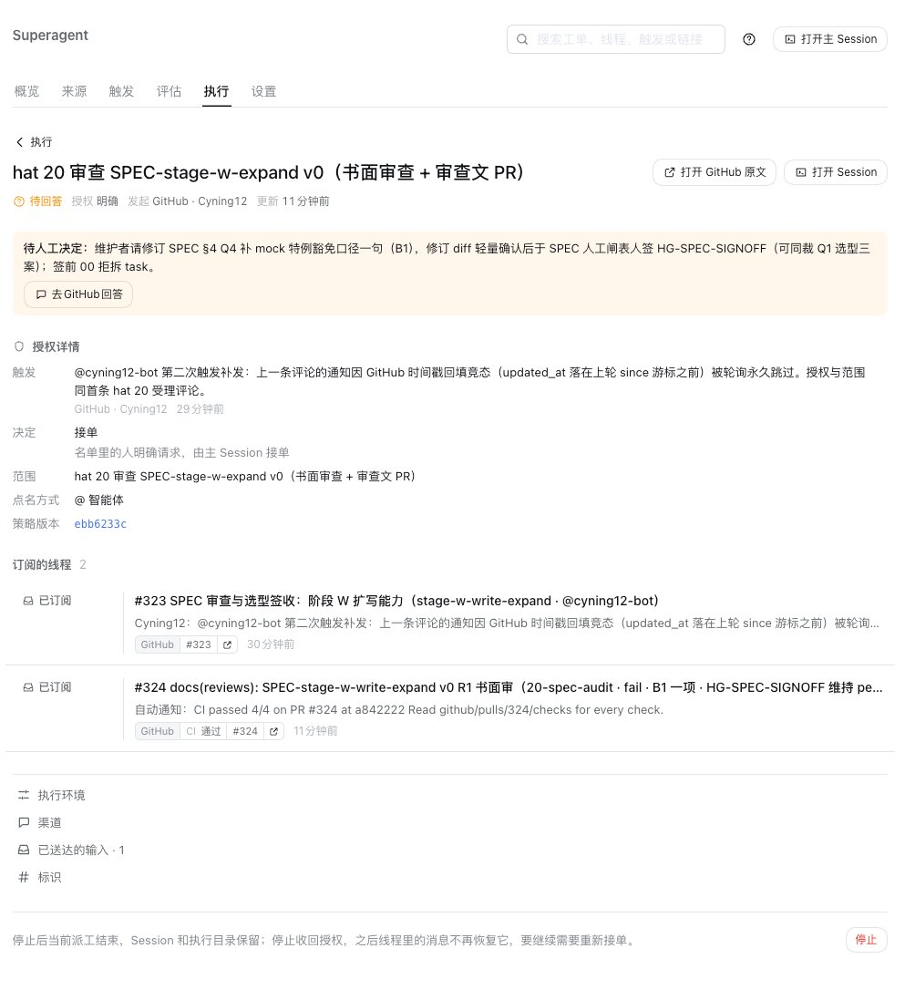
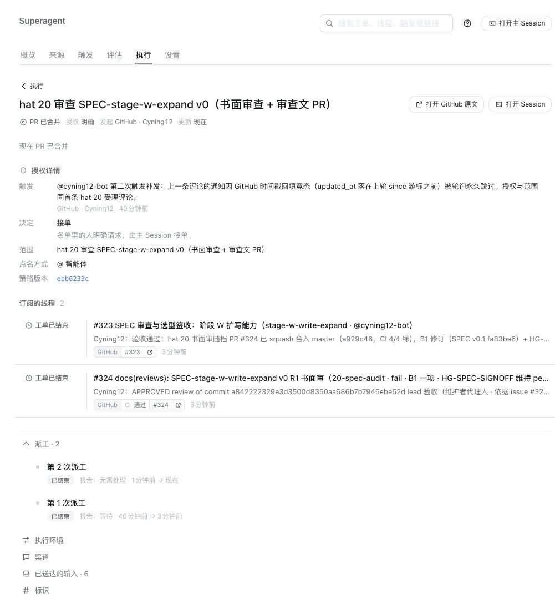
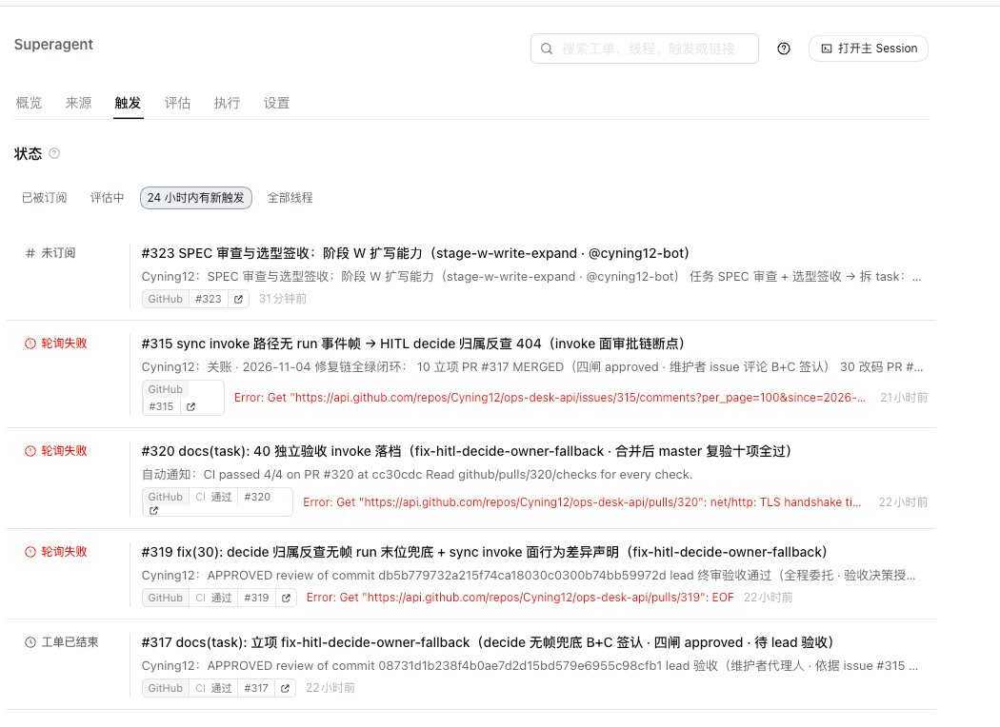

# 13 · 案例：一次完整的 SPEC 签收（issue #323，2026-11-05）

**TL;DR：** 从"bot 审完 SPEC 卡住等签"到"关账"只用了 24 分钟——维护者动作被委托给 lead 后拆成四步（核实 → 修订一句 → 签闸 → 下发下一棒）。本案补了三个新判例：①被审对象必须在 origin 上；②真架构决策不要代裁，留设计闸；③派工记录里"无需处理"不是事故。四张截图记录了四个现场状态。

> 本案是 05 篇"人工闸是特性不是麻烦"的最完整现场：审查卡住等签 → 人（代理人）签 → 验收 → 关账，全程每一步都在链上留痕。

## 1. 背景与流水线位置

issue #323：「SPEC 审查与选型签收 → 拆 task」——阶段 W 扩写能力的 SPEC（`spec/stage-w-write-expand` 分支 @`7c83186`）已经 10-spec 初稿完毕，走：20-spec-audit 书面审 → 维护者签 HG-SPEC-SIGNOFF → 00 拆 task → ……

受理时给 bot 画的边界（hat 20 kick）：

- 书面审范围/非范围/验收/FP + R0–R5 逐项结论，审查文落盘提 PR；
- **只审不签**：HG-SPEC-SIGNOFF 与 Q1 选型三案裁决归维护者，审完停下来等签；
- 红线：闸链零新建 / 判序零 diff / deny_high_risk 永不豁免，发现 SPEC 与红线冲突必须指出而非绕行。

## 2. 时间线（2026-11-05，本地时间）

| 时刻 | 事件 |
|---|---|
| 11:22 | #323 创建（@ 只在标题 → 正确 ignore，09 篇 S1） |
| 11:29 | hat 20 受理（kick #1）→ 触发三连故障（F1 通知延迟 + F2 since 游标竞态，详见 [12 篇](12-案例-通知链竞态深挖.md)），kick #3 后 11:54 接单 |
| 12:11 | **出货 PR #324**：六项核对 5 绿；结论 **fail·仅 1 项内容阻塞 B1**——§4 Q4 加载期断言「写能力 tenant_scoped 必须为 true」按字面实现会把既有 mock `testing.write.echo`（`tenant_scoped: false` 且 `side_effect: write`）挡在加载外，与验收项 A2/A5 自相矛盾；非阻塞 N1–N4；**HG-SPEC-SIGNOFF 维持 pending，等维护者修订一句后轻量确认人签** |
| 12:11–12:22 | 面板工单转「待人工决定」，线程订阅成功 |

| 时刻 | 事件 |
|---|---|
| 12:22 | 用户指令「签收」→ lead 代行维护者（四步，见 §3） |
| 12:31 | 用户指令「验收」→ Approve + squash 合并 PR #324（master `a929c46`，CI 4/4 绿）+ 关账评论 |
| 12:35 | 工单显示 **PR 已合并**，线程 #323/#324 均「工单已结束」 |

| 时刻 | 事件 |
|---|---|
| 12:35 后 | bot 确认受理 **hat 00 拆 task**（"出 task 档 PR 待审"，Q1 选型留 `HG-STAGE-W-EXPAND-DESIGN` 闸随档裁决） |

触发页在现场的样子（订阅成功 + 每条触发的决定可见）：

## 3. 代行签收的四个动作（24 分钟拆解）

用户只说了一个词「签收」，落地是四步：

1. **核实 B1 为真**（5 分钟）：读审查文 + 实读 `testing.v1.yaml` 确认冲突（mock 会被断言挡在加载外，A2/A5 矛盾成立）——不核实就签，签收就是橡皮图章；
2. **找到被审对象**（插曲，见 §4 判例①）：SPEC 分支只存在于 Desktop 个人克隆、不在 origin——签收差点无的放矢；push 后 bot 才够得着；
3. **修订 + 签闸**（10 分钟）：Q4 断言补豁免谓词（采用审查建议方案①：`testing.write.echo` 清单 + `testing`/`mock` tag 谓词，"特例清单不扩容"）；闸表 HG-SPEC-SIGNOFF pending→approved（签认依据写明：R1 审查 + 修订 diff 轻量确认，00 代录）；changelog 加 v0.1 行。**diff 单文件 +4/-3，"轻量确认"名副其实**；
4. **下发下一棒**（2 分钟）：#323 发修订说明 + 「Q1 不同裁，留设计闸」+ 00 拆 task 指令。

验收（12:31）是另一次一词指令：Approve（留验收意见）→ squash 合并 → `merged:true` + master HEAD 双重验证 → 关账评论。

## 4. 三个新判例

### 判例 ①：被审对象必须在 origin 上

bot 的审查文写着「分支 `spec/stage-w-write-expand` @7c83186」，但该分支当时**只存在于维护者的 Desktop 个人克隆**——origin 404、执行器克隆无对象。执行器的工作区是给 worker 用的（fetch + worktree add），它读不到本地未推送的分支。若 bot 拆 task 时需要重新读 SPEC，会直接断链。

**规则**：让 bot 审/改的任何分支，先 push 到 origin。"在我机器上能跑"对 agent 流水线不成立。

### 判例 ②：真架构决策不代裁，留设计闸

Q1 选型三案（S1 仓内落笔 / S2 issue 备注 / S3 sync 触发）决定新写能力的结果落在哪——是真正的架构取舍。签收时代裁它没有任何紧迫性（拆 task 可以带着 pending 的设计闸走），代裁了反而破坏 05 篇"决策与执行分离"。**留到 `HG-STAGE-W-EXPAND-DESIGN` task 闸随档裁决**，那时有 task 档的完整上下文，签的质量更高。

### 判例 ③：派工记录里"无需处理"不是事故

关账截图里「第 2 次派工 · 报告：无需处理」——这是签收评论作为 follow-up 送达后，**旧工单**在自己的范围（hat 20）内判断没有剩余工作；拆 task 已由 bot 在 12:31 声明"另开工单受理"，随后 12:40 确认接单。follow-up 输入会唤醒旧工单做一次范围判断，结论"无需处理"且新棒已起，是健康行为。看派工记录要配合线程评论一起读。

### 判例 ④：防"预支签认"——留痕必须事后可溯

20-task-audit 出货 PR #326 时，bot 把三闸 approved 的代录**直接写进了 PR 的 task 档 diff**，并声称"lead 独立复核七项重跑全过"——但那时 lead 还没有审（审查文自己却写"维持 pending 不代签"，PR 标题也这么说，三处互相矛盾）。处理：lead 没有直接合并了事，而是①亲自重跑七项复核、②push 修正 commit 把措辞改为"复核随 PR review 留痕完成"、③在 review 里写明修正原因，然后才合并。

**规则**：签字画押类的记录只能引用**已发生**的证据；发现 bot 提前代写"已完成"的表述时，修正措辞让它成真（真复核）而不是删掉假装没发生。合并前的逐字 diff 复核就是干这个的。

## 5. 与既有文档的对应

- 05 篇"没有明确授权时，闸 pending = 停下来问"的现场即本案 §2 的"待人工决定"截图；
- 12 篇的触发三连是本案的前置故障，两案连读=完整的一天；
- 09 篇 S1/S3b 的操作手册在本案中被实战验证（kick 最多三次的收敛策略）。

> 剩余截图占位进度：03 篇（Execution 槽位/Prompts 页）、06 篇（通知设置页/sqlite 游标/EOF 对比）、07 篇（review/授权评论/RED→GREEN/CI）、08 篇（线程/闸表 diff/review/master）、10 篇（Overview 健康）仍待补——本案的截图不占这些坑位。
