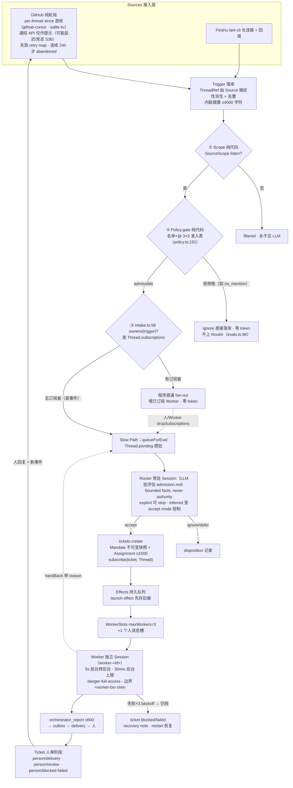

# 附录 · Superagent 数据流一图流

> 一条消息从进来到交付的完整路径。三处**纯代码判定**（零 token）与 LLM 参与的位置已标明；
> 带 `S3b`/行号标注的是源码实证过的机制（见 06/09 篇判例）。

## 读图三句话

1. **LLM 只在两个圆角框里出现**：Router 批评估、Worker 执行。其余所有菱形都是纯代码——钱包（token）只在必要时才打开。
2. **人的回复是闭环**：交付不是终点——人评论产生新事件 → 有订阅 → fan-out 直通 Worker（签收/授权/验收就是这么回到 bot 手里的）。
3. **三个"先"是可靠性支柱**：Mandate 不可变快照、effect 先存后做、report 先入 outbox——任何一步崩溃都能从存储恢复，不丢审批语义。
